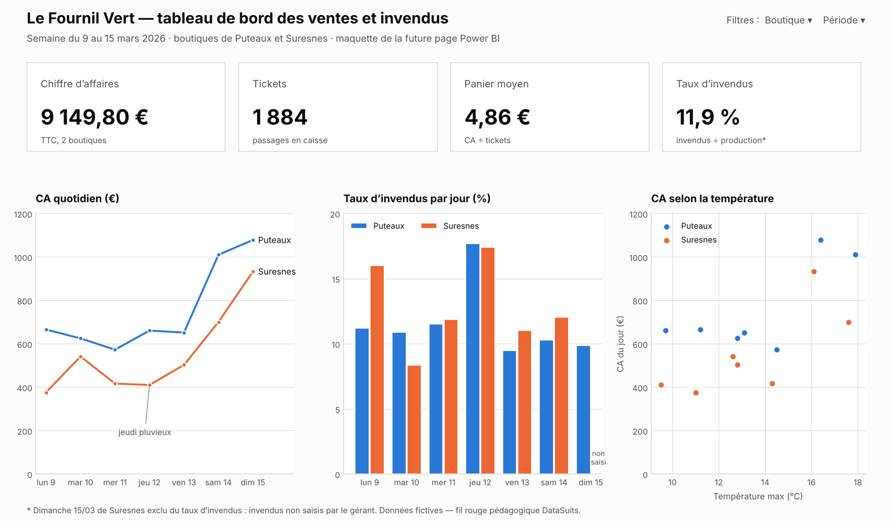
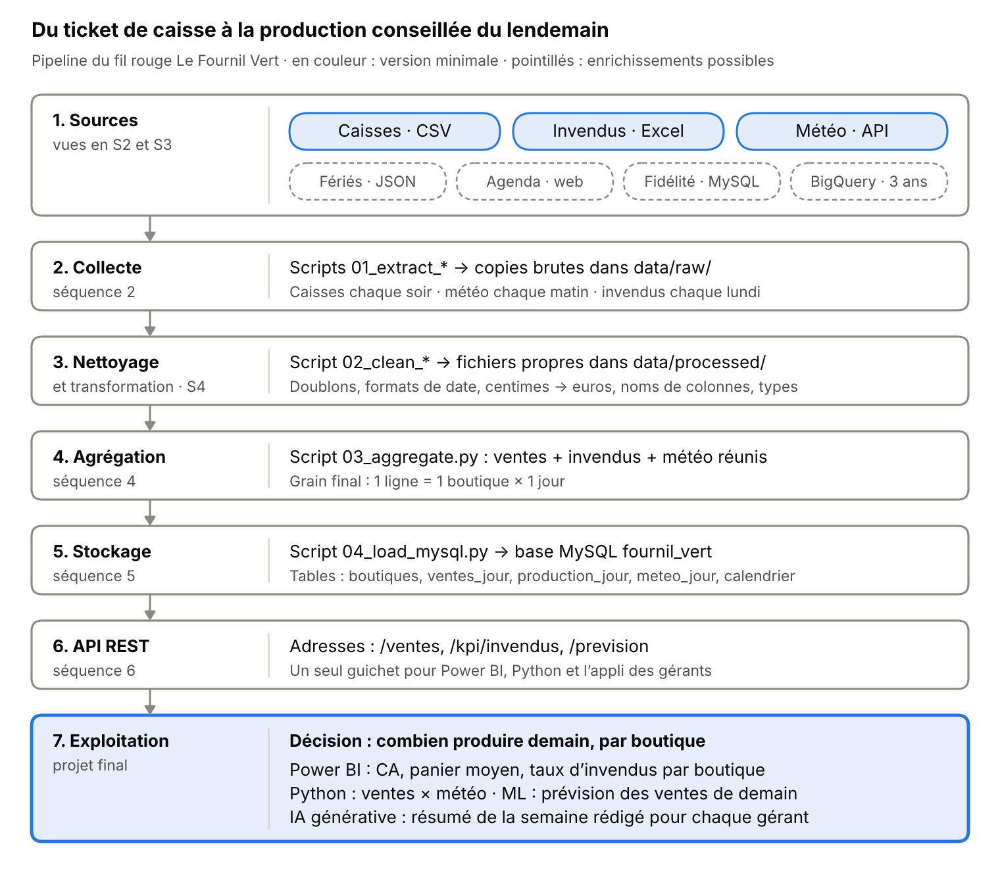

# Le Fournil Vert — réduire les invendus grâce aux données de ventes et de météo

> Projet de démonstration · Formation Data Analyst & IA, DataSuits · Fil rouge du module « Collecte des données dans un projet d'IA » · État : fin de la séquence 1



## 1. Contexte
Le Fournil Vert est une chaîne fictive de 6 boulangeries dans les Hauts-de-Seine. Chaque matin, les gérants décident « au feeling » des quantités à produire. Environ 12 % de la production finit invendue, alors que certaines boutiques sont en rupture dès 18 h les jours de beau temps.

## 2. Problématique
**Question centrale :** Comment ajuster chaque jour la production de chaque boutique pour réduire les invendus sans provoquer de ruptures ?

**Utilisateurs :** la direction (pilotage du réseau) et les 6 gérants (décision de production).

**Questions d'analyse :**
1. Quelles boutiques et quels jours de la semaine concentrent le plus d'invendus ?
2. Comment la température et la pluie font-elles varier les ventes ?
3. Les jours fériés, les vacances et les marchés locaux changent-ils la demande ?
4. Peut-on prévoir les ventes du lendemain assez précisément pour conseiller une quantité à produire ?

## 3. Indicateurs clés (KPI)
| KPI | Calcul | Décision éclairée |
|-----|--------|-------------------|
| Taux d'invendus | Quantité invendue ÷ quantité produite | Quelles boutiques et quels jours réduire la production |
| CA journalier | Somme des montants TTC du jour | Suivre l'activité, repérer les jours atypiques |
| Panier moyen | CA ÷ nombre de tickets | Juger l'effet d'une offre ou d'une formule |
| CA par tranche de température | CA moyen des jours < 10 °C, 10–20 °C, > 20 °C | Adapter le mix produits (sandwichs ou viennoiseries) |
| Évolution vs N-1 | CA du jour ÷ CA du même jour l'an dernier − 1 | Distinguer une tendance d'un effet calendrier |

## 4. Sources de données
| Source | Type | Contenu | Collecte | Fréquence |
|--------|------|---------|----------|-----------|
| Exports de caisse | CSV | 1 ligne = 1 article vendu (date, heure, boutique, produit, montant) | Script | Chaque soir |
| Production et invendus | Excel | Quantités produites et invendues par boutique, jour et famille | Script | Chaque lundi |
| Météo (Open-Meteo) | API (JSON) | Température maximale et pluie par ville et par jour | Script | Chaque matin |
| *Enrichissements possibles* | JSON, page web, MySQL, BigQuery | Jours fériés, agenda des marchés, base fidélité, historique de 3 ans | — | — |

Les fichiers de `data/raw/` sont des données **fictives** couvrant une semaine (9 au 15 mars 2026) pour deux boutiques. Ils contiennent volontairement des défauts de qualité.

## 5. Architecture du pipeline


| Étape | Rôle dans ce projet | Où dans le dépôt | Statut |
|-------|---------------------|------------------|--------|
| 1. Sources | Caisses, invendus et météo : ce qu'il faut pour expliquer les ventes d'une journée | `data/raw/` | Identifiées |
| 2. Collecte | Récupérer automatiquement chaque source à son rythme et garder une copie brute | `scripts/01_extract_meteo.py` | Météo en place, le reste en S2 |
| 3. Nettoyage / transformation | Mettre les deux caisses et l'Excel au même format, retirer les doublons | `scripts/02_clean_ventes.py` | Démonstration, approfondi en S4 |
| 4. Agrégation | Réunir ventes, invendus et météo au grain 1 ligne = 1 boutique × 1 jour | `scripts/03_aggregate.py` | À faire (S4) |
| 5. Stockage | Ranger les données propres dans la base MySQL `fournil_vert` | `sql/` | Base de démonstration en place, finalisée en S5 |
| 6. API | Donner les ventes et les KPI à Power BI, aux notebooks et à l'appli des gérants | `api/` | À faire (S6) |
| 7. Exploitation | Dashboard, analyse de l'effet météo, prévision des ventes, résumé hebdomadaire par IA | `notebooks/`, `dashboard/` | Maquette, projet final |

## 6. Structure du projet
- `data/raw/` : données brutes, jamais modifiées · `data/processed/` : données propres
- `notebooks/` : exploration et analyses · `scripts/` : étapes du pipeline, numérotées dans l'ordre
- `sql/` : création des tables et requêtes · `api/` : API REST
- `dashboard/` : Power BI · `docs/` : schéma du pipeline, journal IA

## 7. Technologies
Python (pandas, requests) · MySQL · Power BI · Git / GitHub · IA générative (ChatGPT, Claude) utilisée comme copilote · à venir : FastAPI (S6)

## 8. Lancer le projet
Depuis le dossier du projet :

```bash
pip install -r requirements.txt
python scripts/01_extract_meteo.py    # météo du jour -> data/raw/
python scripts/02_clean_ventes.py     # caisses nettoyées -> data/processed/
```

Pour la base de démonstration, exécuter dans MySQL Workbench `sql/create_tables.sql`, puis `sql/demo_data.sql`, puis `sql/requetes_exemples.sql`.

## 9. Avancement
- [x] S1 — Architecture, arborescence, README
- [ ] S2 — Collecte automatisée
- [ ] S3 — Extraction SQL et Big Data
- [ ] S4 — Nettoyage et agrégation
- [ ] S5 — Base de données et RGPD
- [ ] S6 — API REST
- [ ] Analyse, dashboard et soutenance

## 10. Limites et points de vigilance
- Données fictives, sur une seule semaine : aucune conclusion statistique n'est possible à ce stade.
- La base fidélité (enrichissement) contient des données personnelles : à traiter selon le RGPD en séquence 5.
- Les invendus dépendent de la saisie des gérants : une saisie oubliée fausse le taux d'invendus.

## 11. Utilisation de l'IA
L'IA a servi à reformuler la problématique, proposer une première architecture, critiquer le grain du dataset et rédiger une première version de ce README. Chaque proposition a été vérifiée : détail des choix gardés et refusés dans [`docs/journal_ia.md`](docs/journal_ia.md).

## Auteur
Équipe pédagogique DataSuits · projet de démonstration pour les apprenants
